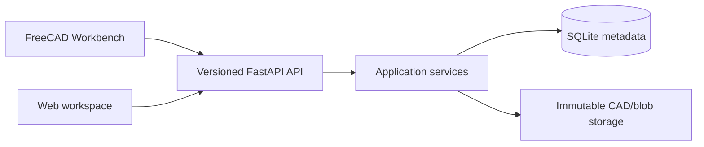

# Architecture

ForgePDM is a Python modular monolith with FreeCAD as an independent HTTP client.
The backend owns business rules and can run without FreeCAD installed.

## Owning modules

| Location | Responsibility |
|---|---|
| `src/forgepdm/domain` | Entities, errors and pure specification/quantity policies |
| `src/forgepdm/application` | Use cases, authorization, transactions, revision and engineering evidence rules |
| `src/forgepdm/infrastructure` | Versioned SQLite migrations, SHA-256 filesystem storage and bounded supplier adapter |
| `src/forgepdm/api/v1` | HTTP validation, authorization entry points and serialization |
| `src/forgepdm/web` | Buildless same-origin HTML/CSS/JavaScript presentation |
| `clients/freecad/freecad/forgepdm` | Native CAD/Qt adapters, standard-library HTTP client, workspaces and command workflows |

Application services currently execute SQL through the database adapter; a
separate generic repository abstraction is not implemented. SQLite is the initial
local adapter; PostgreSQL and network/object storage remain future deployment
work. CAD bytes live outside metadata, never as client-chosen server paths.

## Transactions and exact identity

Human item numbers are permanent business identifiers; opaque UUIDs carry
identity. BOMs pin exact revisions. CAD manifests additionally pin the exact
native dataset/file/object. These are separate graphs: saving/uploading CAD does
not synchronize engineering quantities. Display labels never determine identity.

File ingest stages/hashes bytes, atomically promotes immutable blobs and commits
metadata under explicit transactions. Failure after promotion may leave an
unreferenced blob; diagnostics are read-only and automatic GC is deferred.
Native part/assembly check-in commits snapshot, exact manifest/evidence, audit and
checkout release together. Fenced lease IDs/versions and actor-scoped replay
protect uploads, check-in, revision creation and derived PDF publication.

Read-only shared BOM reports use one database snapshot for permissions, exact
pins, quantities and component mass evidence. Clients select server-generated
views; one leaf rollup prevents indented parent/child mass double counting.
Drawings embed frozen report values and SVG until explicitly updated.

## Client and runtime boundaries

FreeCAD uses GUI-thread CAD/widget operations and worker HTTP/transfers. Startup
imports perform no networking. The addon is packaged independently, with no
backend imports or separately installed runtime dependencies. Local working
copies, verified caches and durable journals preserve original CAD and newer edits.
The small standard-part contract is deliberately duplicated with a parity test.

Web tokens stay in memory. The backend serves static assets with same-origin
security headers; engineering APIs authorize every request. Supplier lookup
performs bounded outbound requests outside DB transactions, then revalidates
checkout/specification before saving enrichment. It never blocks ordinary item
registration when a mass source is unavailable.

## References and boundaries

Teamcenter informed Item/Revision/Dataset/BOM/Lifecycle separation. EasyPDM
provided a practical CAD/service workflow reference; ForgePDM does not assume
identical technology, domain rules or deployment. The original macros informed
workflow requirements and are [retained in Git history](../history/provenance.md).
Numbered [ADRs](../decisions/README.md) record decisions and supersession.

ForgePDM owns engineering identity, CAD, revisions and BOMs. Inventory, purchasing,
costing, manufacturing execution, effectivity, general workflow design and ERPNext
synchronization are outside current delivery. Production hardening is tracked in
[the roadmap](roadmap.md). See [domain rules](domain-model.md), [API contracts](api.md)
and [test tiers](testing.md) before changing these boundaries.
